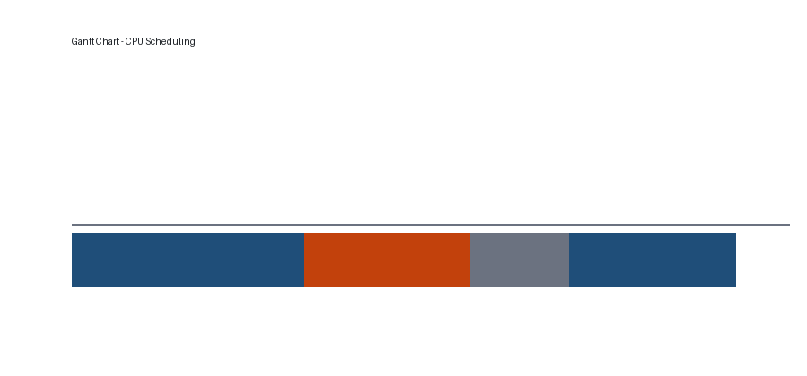

# بخش نخست: سرفصل بسیار طولانی برای بررسی شکستن سطر در فهرست مطالب و سرصفحهٔ سند

متن کوتاه برای شروع.

## زیربخش با عنوان طولانی‌تر که باید در فهرست به‌درستی نمایش داده شود

- آیتم سطح اول
  - زیرآیتم سطح دوم با متن کمی طولانی‌تر
    - زیرآیتم سطح سوم
- آیتم دیگر
1. مورد شماره‌دار نخست
2. مورد شماره‌دار دوم
3. مورد شماره‌دار سوم

### عنوان سطح سه بدون خط جداکننده

پاراگراف با نشانه‌گذاری‌های مختلف: **پررنگ**، *مورب*، و `کد درون‌خطی` در کنار اعداد انگلیسی مثل 42 و عدد فارسی ۴۲ و نمادهای ریاضی x^2 و \alpha و \frac{a}{b}.



> نقل‌قول کوتاه برای آزمایش کادر.

> نقل‌قول بلندتر: این متن عمداً طولانی‌تر نوشته شده تا مشخص شود ارتفاع کادر پس‌زمینه با تعداد سطرهای متن هماهنگ می‌شود و متن درون کادر به‌درستی می‌شکند. اگر کادر کوتاه‌تر از متن باشد، بخشی از متن بیرون می‌زند و اگر بلندتر باشد، فاصلهٔ اضافی دیده می‌شود.

| ستون یک | ستون دو | ستون سه | ستون چهار |
| --- | --- | --- | --- |
| دادهٔ کوتاه | متن بسیار طولانی‌تر برای آزمایش شکستن سطر درون خانهٔ جدول که باید در چند سطر نمایش داده شود | ۱۲۳ | ok |
| ردیف دوم | مقدار | ۲۰۲۱ | تمام |

```bash
# نمونهٔ دستور
grep -rn "TODO" src/ | wc -l
```

متن پایانی.
